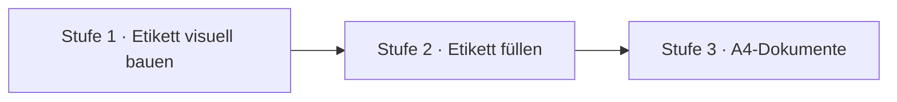
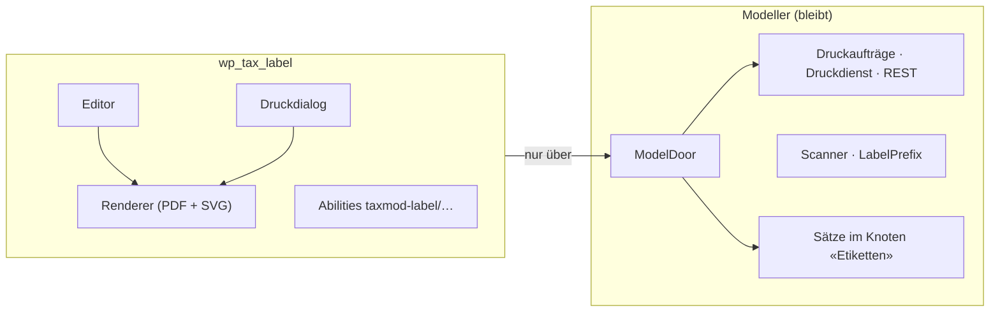
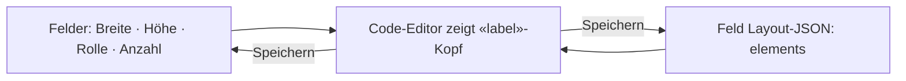
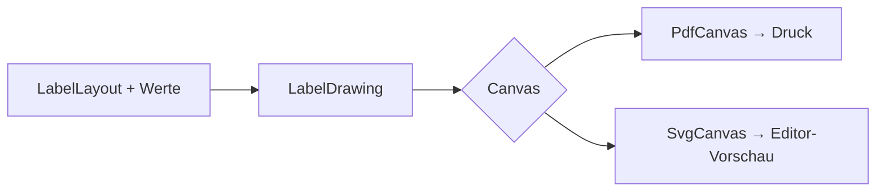
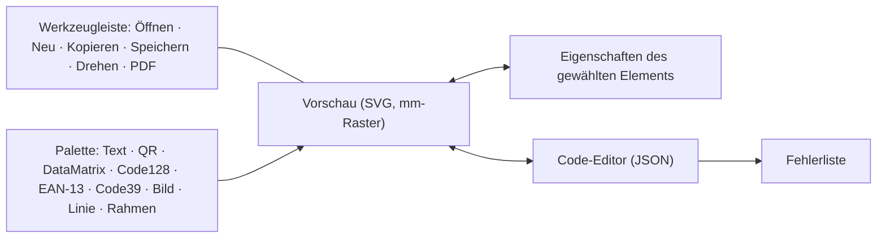

# wp_tax_label — Konzept

Stand 2026-11-10 · vor 1.0 · Grundlage D-1292, D-1293, D-1294 ([Log](https://github.com/sfambach/wp-taxonomy-modeler/blob/main/docs/NewConcept/90-decision-log.md)) und Stefans Antworten im Thread «Label-Modul mit Etiketten-Editor bauen» vom 10.11.2026.

Das Modul übernimmt **alles zum Etikett**: Editor, Layout, Renderer, Druckdialog und die Etiketten-Abilities. Installiert hängt es sich in die Taxonomy-Logistik ein; fehlt es, zeigen die Gastseiten keinen Druckknopf.

## 1 · Stufen



| Stufe | Inhalt | Status |
|---|---|---|
| 1 | Umzug aus Modeller und Lager, Editor mit Vorschau und JSON, neue Elemente | **dieses Paket** |
| 2 | Felder füllen: Feldauswahl im Element, Ersatzregeln «wenn A leer, dann B», je Knoten | offen (Abschnitt 8) |
| 3 | A4-Dokumente mit wiederkehrenden Zeilen (Rechnung, Stückliste, Bestückungsliste), Logo-Galerie | Version 2 |

## 2 · Was wohin gehört (D-1292)



- **Zieht ins Modul:** LabelDocument, LabelElement, LabelLayout, LabelFormat, LabelTemplate, LabelContent, FilledLabel, PdfDocument, HelveticaMetrics, QrCode, ReedSolomon, LabelPrinter, LabelButton, LabelPreview, LabelPrint, Ability `print-label`; aus dem Lager LabelTemplates, LabelContents, LabelChanges, LabelAbilities.
- **Bleibt im Modeller:** Druckaufträge samt Druckdienst und REST, Scanner, `LabelPrefix`, die Etiketten-Sätze.
- **Zugriff** auf Sätze und Druckaufträge nur über `ModelDoor` (D-1292).
- **Andocken:** Die Gastseite fragt einen benannten Filter (`taxmod_label_button`, `taxmod_config_tabs`); das Modul beantwortet ihn. Eine neue Andockstelle wird beim Architektur-Thread angefragt.

Übergang: erst das Modul vollständig und geprüft, dann Modeller und Lager **in einem Einspielvorgang** ohne Etikettencode, sonst antworten zwei Handler auf `taxmod_label_button`.

## 3 · Das Etikett

Ein Etikett ist ein Satz im Knoten «Etiketten» (D-1153). Die Maße bleiben Felder (Breite, Höhe, Rolle, Anzahl). Das Layout-JSON speichert nur die Elemente (Stefan 10.11.: «Felder, JSON zeigt sie»).



Der Code-Editor zeigt beides als ein Dokument. Beim Speichern geht der Kopf zurück in die Felder, die Elemente ins Layout-Feld. So gibt es jede Angabe genau einmal.

```json
// CONTRACT — was der Code-Editor zeigt
{
  "label": { "w": 62, "h": 30, "roll": 62, "copies": 1 },
  "elements": [
    { "type": "qr", "field": "code", "x": 3, "y": 3, "w": 24, "h": 24 },
    { "type": "text", "field": "title", "x": 30, "y": 3, "w": 29, "h": 12, "pt": 28, "bold": true, "fit": "shrink" }
  ]
}
```

Ein gespeichertes Layout im alten Format (nur eine Liste von Elementen, deutsche Schlüssel wie `typ`, `feld`) wird weiter gelesen.

**Drehen** ist nur eine Ansicht im Editor. Wie gedreht gedruckt wird, entscheidet der Drucker (D-1191, Stefan 10.11.: «Nur Ansicht»).

## 4 · Elemente

| Typ | Zweck | Eigene Eigenschaften |
|---|---|---|
| `text` | Feldwert oder fester Text | `field` oder `text`, `pt`, `bold`, `lines`, `center`/`right`, `bottom`, `short`, `fit` |
| `qr` | QR-Code (wie heute) | `field` |
| `datamatrix` | DataMatrix ECC 200, klein und dicht | `field` |
| `code128` | 1D-Code, liest jeder Scanner | `field`, `human` (Klartext darunter) |
| `ean13` | Handelsware, 12/13 Ziffern | `field`, `human` |
| `code39` | alte Scanner, Industrie | `field`, `human` |
| `image` | Bild/Logo aus der WP-Mediathek | `media` (`media:<id>`), `keep` (Seitenverhältnis) |
| `line` | waagrechte oder senkrechte Linie, Schnittmarke (D-1237): ein gefüllter Balken über die Box | — |
| `rect` | Rahmen, ein Rechteck aus vier Linien | `stroke` (Strichstärke in mm, Standard 0,3) |

Alle Elemente haben `x`, `y`, `w`, `h` in mm ab der linken oberen Ecke, dazu `example` (Beispielwert für die Vorschau, D-1154).

**Text und Rahmen** (Stefan 10.11.):

| `fit` | Verhalten |
|---|---|
| `shrink` (Standard) | Die Schrift wird kleiner, bis der Text in den Rahmen passt. |
| `grow-down` | Die Schrift bleibt bei `pt`, der Text bricht um, der Rahmen wird höher. |
| `grow-right` | Die Schrift bleibt bei `pt`, eine Zeile, der Rahmen wird breiter. |

Wächst ein Rahmen über das Etikett hinaus, ist das ein Fehler (Abschnitt 6).

**Bilder** kommen nur aus der Mediathek (Stefan 10.11.). Die Grenzschicht löst `media:<id>` in eine Datei auf; der Kern bekommt nur die Bytes. Erlaubt sind JPEG und PNG.

## 5 · Ein Renderer, zwei Zeichenflächen



Die Barcode-Logik und die Textanpassung gibt es nur einmal, in PHP. Der Editor holt die Vorschau als SVG per REST. Was der Editor zeigt, ist also genau das, was gedruckt wird. Das ist der «Editor-Renderer» aus Stefans Wunsch.

```php
// CONTRACT
interface Canvas
{
    public function page(float $widthMm, float $heightMm): void;
    public function rectangle(float $xMm, float $yMm, float $wMm, float $hMm): void;
    public function text(float $xMm, float $baselineMm, string $text, float $pt, bool $bold): void;
    public function image(float $xMm, float $yMm, float $wMm, float $hMm, Picture $picture): void;
}
```

Barcodes zeichnen sich als Rechtecke (Module oder Balken), wie der QR-Code heute.

## 6 · Der Editor

Ort: **Einstellungen › Druck › Etiketten**, wo heute die Etikettenvorlagen sind (Stefan 10.11.). Seite über `ListPage::page`, eigenes JavaScript ohne Build und ohne CDN (D-1292).



- **Ziehen und Ablegen:** Element aus der Palette auf die Vorschau ziehen; verschieben, Größe an den Griffen ändern; Raster 0,5 mm; Pfeiltasten verschieben um 0,5 mm.
- **Etikett-Einstellungen** als Eingabefelder über der Vorschau: Breite, Höhe, Rolle, Anzahl. Sie schreiben sofort in den «label»-Kopf des JSON (Stefan 10.11.: «soll der Nutzer natürlich nicht ins JSON eintippen»). Niemand muss JSON tippen; wer will, kann es.
- **Eigenschaften:** Feld oder fester Text, Schriftgröße, fett, Ausrichtung, `fit`, Beispielwert; Bild über die Mediathek-Auswahl.
- **Code-Editor:** zeigt das JSON aus Abschnitt 3 und folgt jeder Änderung in der Vorschau, und umgekehrt.
- **Fehler** zeigt der Editor sofort, mit Zeile und Element. Ein Etikett mit Fehlern lässt sich nicht speichern.
  - JSON nicht lesbar (mit Zeilennummer)
  - Element ragt über das Etikett
  - Code-Wert passt nicht (EAN-13 braucht 12 oder 13 Ziffern; Code39 nur A–Z, 0–9, `-. $/+%`)
  - Bild fehlt in der Mediathek
- **Öffnen / Neu / Kopieren:** Liste der Etiketten nach Kategorie; Kopieren legt einen neuen Satz in derselben Kategorie an.
- **Drehen:** dreht nur die Ansicht in 90°-Schritten.
- **PDF:** das echte Etikett als PDF mit Beispielwerten, ohne Druck.
- **Rückgängig:** jeder Schritt im Editor lässt sich zurücknehmen; Löschen eines Etiketts gibt das alte Etikett für «Wiederherstellen» zurück (wie `label-remove` heute).

## 7 · Abilities und Andockstellen

| Heute | Neu |
|---|---|
| `taxmod-stock/labels` | `taxmod-label/labels` |
| `taxmod-stock/label-save` | `taxmod-label/label-save` |
| `taxmod-stock/label-remove` | `taxmod-label/label-remove` |
| `taxmod/print-label` | `taxmod-label/print` |
| — | `taxmod-label/preview` (SVG oder PDF eines Layouts) |

Druckaufträge-Abilities (`print-jobs`, `print-job`) bleiben im Modeller und behalten ihre Namen.

Andockstellen (D-1292, D-1294):

| Filter | Wer fragt | Was das Modul antwortet |
|---|---|---|
| `taxmod_label_button` | Gastseiten (Modeller, Lager …) | den Druckknopf mit Dialog |
| `taxmod_logistics_pages`, Bereich `print` | Lager-Menü | die Seite «Druck › Etiketten» |
| `taxmod_print_render` | Druckaufträge ohne fertiges PDF («Nochmal drucken») | das PDF |

Druckaufträge legt das Modul über `ModelDoor::queuePrint($pdf, $format, $copies, $title)` an; der Modeller speichert das fertige PDF und liefert es dem Druckdienst unverändert (D-1294).

## 8 · Stufe 2 — Felder füllen (offen)

Heute: ein Element liest ein Feld des Satzes nach Namen (D-1160), «A|B» nimmt das erste gefüllte (D-1217). Feste Felder wie `code`, `title`, `subtitle`, `inhalt` setzt der jeweilige Aufrufer im Code.

Zu entscheiden, bevor gebaut wird:

- Feldauswahl im Editor aus den Feldern des Knotens, statt Namen zu tippen.
- Ersatzregeln: Kette von Quellen, «wenn A leer, dann B».
- Regeln je Knoten: «ist es ein Widerstand, dann Widerstandswert».
- Woher die festen Felder (`code`, `title`, `inhalt`) kommen, wenn nicht aus dem Code.

## 9 · Stufe 3 — Dokumente (Version 2)

Dasselbe Layout auf A4, mit einem Bereich, der sich je Zeile wiederholt (Rechnung, Stückliste) und Seitenumbruch. Logo-Galerie. Druck über dieselben Druckaufträge (D-1292).

## 10 · Annahmen (nicht vom Konzept gedeckt)

- Raster 0,5 mm und Pfeiltasten-Schritt 0,5 mm.
- `human` (Klartext unter 1D-Codes) ist standardmäßig an.
- PNG mit Transparenz wird auf Weiß gelegt.
- Feste Texte (`text` statt `field`) sind Daten des Etiketts, keine Software-Texte (AR-2).
